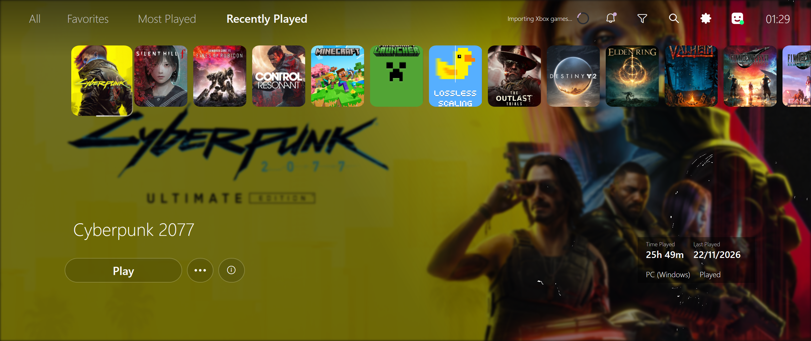

# PS5 Core

A PlayStation 5-inspired **fullscreen theme for [Playnite](https://playnite.link)**, tuned for 21:9 ultrawide displays (developed on 2560x1080 @ 75 Hz).



## Features

- Horizontal row of portrait cover cards with rounded corners
- Selected card grows from its top edge and never overlaps its neighbours
- Animated selection ring: a fading comet-tail that circles the card
- Card flow-in animation on startup
- PS5-style top bar: categories, notifications, filters, search, settings, profile avatar and clock
- Play / more / info pill buttons below the game title, reachable with the D-Pad; controller hints appear under a button on hover
- Side panels for the main menu, filters and game menu that open at consistent positions
- High-contrast focus states on checkboxes, sliders and menu rows (blue selection color with a gap)
- Game details: playtime, last played, platform and completion status

## Installation

### From a release

1. Download `PS5Core_<version>.pthm` from the [latest release](../../releases/latest).
2. Double-click the file, or drag it onto Playnite. Playnite installs and offers to restart.
3. In Playnite: **Settings > Appearance > Fullscreen > Theme > PS5 Core**.

### Manual

Copy the contents of the `theme` folder to:

```
%AppData%\Playnite\Themes\Fullscreen\PS5Core_624c9750-204a-447a-99d9-6c2910b89211\
```

Then select the theme as above.

## Recommended settings

| Setting | Value |
| --- | --- |
| Fullscreen rows | 1 |
| Fullscreen columns | 12 or more (the row scrolls horizontally) |
| Show game titles in grid | Off |

## Compatibility

- Playnite 10 (theme API 2.0.0)
- Tested at 2560x1080 and 16:9 is expected to work, but is not the primary target
- Uses the Segoe UI and Segoe Fluent Icons fonts that ship with Windows 11

## Known limitations

- When a menu closes, Playnite returns focus to the game list. A theme cannot change this.
- The top bar buttons (notifications, filters, search, settings, profile) are not reachable with the D-Pad; this is how Playnite fullscreen mode works.
- The filter panel, notifications panel and game details page have had less testing than the home screen.

## Building a release

```powershell
Compress-Archive -Path theme\* -DestinationPath PS5Core_1.0.zip
Rename-Item PS5Core_1.0.zip PS5Core_1.0.pthm
```

## Credits and licenses

- Theme code: [MIT](LICENSE), by S0up12.
- Based on the structure of the Playnite **Default** fullscreen theme (MIT, (c) Josef Nemec). `Images/applogo_clean.png`, `Images/custom_cover_background.png` and `Images/ButtonPrompts` are taken unchanged from it.
- Visual direction inspired by the community Figma file [PS5 Interactive UI](https://www.figma.com/design/1obxzkvpdupnNEyQkaYw7W/PS5-Interactive-UI--Community-). No files from it are included.
- Screenshots show game art that belongs to its respective owners.
- This is an unofficial fan project. PlayStation and PS5 are trademarks of Sony Interactive Entertainment Inc. This project is not affiliated with or endorsed by Sony.
